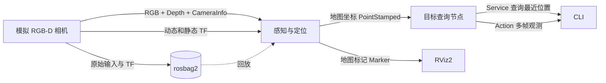

# ROS 2 学习 Demo · 给红色目标做地图定位

一台模拟相机随机器狗底座移动，持续观测地图上固定的红色目标。验收时应看到相机坐标中的目标位置随运动变化，而 `map` 中的位置始终接近 **`(2.00, 0.25, 0.75) m`**。录包后回放也能重新算出这个结果。合成画面用红色圆斑代表杯子，检测器用颜色阈值，运行需要 ROS 2 Jazzy 和 Python 3。



## 1. 构建并启动

在工作区根目录执行。以下示例适用于 Ubuntu 24.04 上通过 apt 安装的 ROS 2 Jazzy。如果已经安装 ROS 2 Desktop 和构建工具，可以直接从 `source` 开始。

如果终端提示符带有 `(base)` 或其他 Conda 环境名，先执行 `conda deactivate`，再加载 ROS 环境。运行本 Demo 时，`python3` 应指向 `/usr/bin/python3`，版本为 3.12。节点通过 `/usr/bin/env python3` 启动，Conda 的其他 Python 版本会导致 `rclpy._rclpy_pybind11` 导入失败。

首次准备环境时安装依赖。已安装时可跳过。`build-essential` 提供接口编译工具。

```bash
sudo apt install build-essential python3-colcon-common-extensions \
  ros-jazzy-desktop ros-jazzy-rosbag2-storage-mcap
```

加载系统 ROS 2，使当前终端能够找到 `ros2` 命令和 Jazzy 的 Python 库。

```bash
source /opt/ros/jazzy/setup.bash
```

在工作区根目录编译两个包。正常结束时应显示 `2 packages finished`。

```bash
colcon build
```

加载本工作区，使当前终端能够找到 Demo 节点和自定义 Service、Action 类型。环境设置只对当前终端生效，每个新终端都要重新加载。

```bash
source install/setup.bash
```

启动三个节点并打开 RViz2。此命令持续运行，后续调试命令在其他终端执行。正常时可看到相机图像、移动的坐标轴，以及地图上位置稳定的红球。

```bash
ros2 launch ros2_perception_demo demo.launch.py rviz:=true
```

纯命令行环境可以省略 `rviz:=true`。新开的终端先执行 `source /opt/ros/jazzy/setup.bash` 和 `source install/setup.bash`。RViz2 的固定坐标系是 `map`，可以同时看 RGB 图像、移动的 TF 坐标轴和固定的红球。

## 2. 练习 Topic、Service 和 Action

查看已经参与通信的节点，应包含 `/mock_rgbd`、`/localize_target`、`/target_query`。刚启动时节点发现需要少量时间，列表为空时等一两秒再执行。

```bash
ros2 node list
```

列出话题及消息类型。`-t` 表示同时显示类型，便于确认接口是否符合预期。

```bash
ros2 topic list -t
```

查看 RGB 图像的发布者、订阅者和 QoS。应有 `mock_rgbd` 发布、`localize_target` 订阅，两端可靠性均为 `BEST_EFFORT`。

```bash
ros2 topic info /camera/color/image_raw --verbose
```

接收一条相机坐标点后退出。`--once` 表示只接收一条。`frame_id` 应为 `camera_optical_frame`，多次执行时位置会随相机运动变化。

```bash
ros2 topic echo /target/point_camera --once
```

接收一条地图坐标点，`frame_id` 应为 `map`，位置接近 `(2.00, 0.25, 0.75)` 米。两条 `echo` 分别取样，不能仅靠这两次输出判断同一帧的时间戳是否一致。

```bash
ros2 topic echo /target/point_map --once
```

查看 Service 定义。`---` 上方是请求字段，下方是响应字段。本接口请求为空。

```bash
ros2 interface show ros2_perception_interfaces/srv/GetTarget
```

发出一次查询。`'{}'` 是空请求。正常应返回 `found=True` 和 `Fresh observation`。`position` 是缓存的最近观测，采集时间距当前 ROS 时间超过 1 秒时会返回 `found=False`。

```bash
ros2 service call /target/get_latest ros2_perception_interfaces/srv/GetTarget '{}'
```

查看 Action 定义。两个 `---` 依次分隔 Goal（目标）、Result（结果）、Feedback（反馈）。

```bash
ros2 interface show ros2_perception_interfaces/action/ObserveTarget
```

要求收集任务接受后到达的 10 帧，最多等待 5 秒。`--feedback` 打印中间进度。应先显示 `Goal accepted`，计数逐渐到 10，最后显示 `SUCCEEDED` 和平均位置。

```bash
ros2 action send_goal /target/observe ros2_perception_interfaces/action/ObserveTarget \
  '{required_samples: 10, timeout_sec: 5.0}' --feedback
```

可以用同一个图像话题验证 QoS 兼容性。第一条命令会收到图像的时间戳和坐标系。第二条把订阅端设为 `reliable`，与相机发布端的 `best_effort` 不兼容，用 `Ctrl+C` 结束等待。

只打印一条图像消息的 `header`，避免输出大段像素数据。`best_effort` 与相机发布端兼容，应收到 `stamp` 和 `camera_optical_frame`。

```bash
ros2 topic echo /camera/color/image_raw --field header --once --qos-reliability best_effort
```

故意使用不兼容的 `reliable` 订阅，观察 QoS 提示和持续等待，再按 `Ctrl+C` 退出。

```bash
ros2 topic echo /camera/color/image_raw --field header --once --qos-reliability reliable
```

| 通信 | 接口 | 可观察的行为 |
| --- | --- | --- |
| Topic | `/camera/color/image_raw`、`/camera/depth/image_raw`、`/camera/color/camera_info` | 模拟源以约 10 Hz 发布同一观测的三条消息，使用 `best_effort` |
| Topic | `/target/point_camera`、`/target/point_map` | 两个 `PointStamped` 对应同一采集时间，分别表示光学坐标和地图坐标 |
| Topic | `/target/marker` | 发布 `visualization_msgs/Marker`，供 RViz2 显示定位结果 |
| Service | `/target/get_latest` | 立即返回最近一帧，有效期默认 1 秒，按 ROS 时间计算 |
| Action | `/target/observe` | 收集接受目标后到达的 N 帧，逐帧反馈计数和位置，成功时返回平均位置。一次接受一个目标，超时用单调时钟计时 |

测试超时时，可以让相机画面暂时没有目标。等一两秒后再次调用 Service，应看到 `found=False`。此时发 10 帧的 Action 会在指定时间后返回 `ABORTED`。

隐藏目标，相机继续发图，感知节点将停止产生新的目标点。

```bash
ros2 param set /mock_rgbd target_visible false
```

等待缓存过期后查询，应返回 `found=False` 和 `No fresh observation`。

```bash
sleep 2
ros2 service call /target/get_latest ros2_perception_interfaces/srv/GetTarget '{}'
```

此时没有新目标点，2 秒后应返回 `ABORTED` 和 `Timed out`。

```bash
ros2 action send_goal /target/observe ros2_perception_interfaces/action/ObserveTarget \
  '{required_samples: 10, timeout_sec: 2.0}' --feedback
```

完成超时实验后恢复目标，为后面的取消、定位和录包练习准备数据。

```bash
ros2 param set /mock_rgbd target_visible true
```

恢复目标后，在一个终端发出下面的 300 帧任务。看到反馈后，在另一个终端调用取消服务。空请求会取消该 Action 的所有活动目标，本 Demo 同时最多接受一个。取消服务应返回 `return_code=0`，发送目标的终端应显示 `CANCELED`。

发送目标的终端。约 10 Hz 的输入下，300 帧需要约 30 秒，留出发送取消请求的时间。让本命令保持运行，看到数帧反馈后，在另一个已加载环境的终端执行取消命令。

```bash
ros2 action send_goal /target/observe ros2_perception_interfaces/action/ObserveTarget \
  '{required_samples: 300, timeout_sec: 60.0}' --feedback
```

另一个终端。向该 Action 的取消服务发空请求，取消它的所有活动目标。本终端应看到 `return_code=0`，发送目标的终端应看到 `CANCELED`。

```bash
ros2 service call /target/observe/_action/cancel_goal action_msgs/srv/CancelGoal '{}'
```

## 3. 验证 TF2 和时间戳

```text
map → base_link → camera_link → camera_optical_frame
      动态         静态           静态
```

RGB、对齐深度和 `CameraInfo` 通过 `TimeSynchronizer` 按 `header.stamp` 精确配对。感知节点从红色区域中取有效深度像素的中心和深度中位数，用 `CameraInfo.p` 中的内参反投影。输入约定是已校正的 `rgb8`、以毫米表示的 `16UC1` 深度和同一光学坐标系，深度零值表示无效。

光学坐标系的轴为右、下、前，底座坐标系的轴为前、左、上。定位节点用 `lookup_transform('map', optical_frame, image_stamp)` 查观测时刻的变换，发布时保留原始时间戳。若 TF 暂未到达，节点会在后续回调中重试，超过 `tf_wait_sec` 后丢弃该地图观测。光学坐标结果仍可用于排查检测和 TF 分别在哪一步失败。

持续查看把相机光学坐标转换到 `map` 的平移和旋转，数值会随底座运动变化。此命令持续运行，观察后按 `Ctrl+C` 退出，再执行下一条。

```bash
ros2 run tf2_ros tf2_echo map camera_optical_frame
```

接收一条静态 TF。`transient_local` 让后启动的订阅者也能收到已发布的外参。应包含 `base_link` → `camera_link`，以及 `camera_link` → `camera_optical_frame`。

```bash
ros2 topic echo /tf_static --once --qos-durability transient_local
```

模拟相机让 RGB-D 晚约 200 ms 发出。保持 demo 运行，在另一个终端切换 `use_latest_tf`，连续观察 `/target/point_map` 或 RViz2。使用最新 TF 时，红球会随底座运动来回偏移。切回按采集时间查询后，地图坐标的误差主要来自像素取整，应在 2 cm 内。

故意改用最新 TF。设置后先观察 RViz2 中的红球或多次查看 `/target/point_map`。图像延迟约 200 ms，使用更新的底座位姿会让目标位置出现明显偏移。

```bash
ros2 param set /localize_target use_latest_tf true
```

观察完偏移后再执行本条，恢复按图像采集时间查询，位置应重新接近目标真值。

```bash
ros2 param set /localize_target use_latest_tf false
```

## 4. 用 rosbag2 重跑同一条感知链路

**录制。** 保持实时 demo 运行，确保目标可见，在另一个终端录制约 10 秒。用 `Ctrl+C` 正常结束录制，再用 `info` 确认有 5 个输入话题，`/tf_static` 应至少有 1 条。重复练习时换一个新的输出目录名。

在工作区中创建录包的父目录。`bags/red_target` 由录制命令创建。

```bash
mkdir -p bags
```

从已安装包的位置找到 QoS 配置，其中保留 `/tf_static` 的 `transient_local` 策略。

```bash
QOS="$(ros2 pkg prefix --share ros2_perception_demo)/config/bag_qos.yaml"
```

`-s mcap` 选择存储格式，`-o` 指定新的输出目录，`--topics` 指定需要录制的 5 个输入话题。让相机运行并录制约 10 秒，按 `Ctrl+C` 结束录制，等元数据写完后再执行下一条。

```bash
ros2 bag record -s mcap -o bags/red_target --qos-profile-overrides-path "$QOS" \
  --topics /camera/color/image_raw /camera/depth/image_raw /camera/color/camera_info /tf /tf_static
```

查看时长、消息数和话题列表。每个输入话题应有消息，`/tf_static` 至少有 1 条。

```bash
ros2 bag info bags/red_target
```

**回放。** 停掉实时 launch，在一个终端启动回放模式。它启动感知和查询节点，并为它们和 RViz2 设置 `use_sim_time=true`。在另一个终端启动 bag 播放器，用 `--clock` 发布回放时间，用 `--delay` 给话题发现留出时间。需要更多时间观察时可以加 `--rate 0.5`。

终端 A，先用 `Ctrl+C` 结束之前的实时 launch，再启动本命令并保持运行。`replay` 模式从 bag 接收输入，感知、查询和 RViz2 使用播放器提供的 ROS 时间。

```bash
ros2 launch ros2_perception_demo demo.launch.py mode:=replay rviz:=true
```

终端 B，先加载 ROS 和工作区环境，并进入录包时的工作区根目录。

```bash
QOS="$(ros2 pkg prefix --share ros2_perception_demo)/config/bag_qos.yaml"
```

`--clock` 发布回放时间，`--delay 1` 等待 1 秒再开始播放，给话题发现留出时间。QoS 配置确保播放器为后启动的 TF 监听器保留静态外参。

```bash
ros2 bag play bags/red_target --clock --delay 1 --qos-profile-overrides-path "$QOS"
```

终端 C，先加载环境，在播放期间执行。重新计算的位置应接近 `(2.00, 0.25, 0.75)` 米。

```bash
ros2 topic echo /target/point_map --once
```

Bag 里只有相机输入和 TF，所以回放期间看到的 `/target/point_map` 来自感知节点的重新计算。`bag_qos.yaml` 显式保留 `/tf_static` 的 `transient_local`，让较晚加入的监听器也能在播放器运行期间收到相机外参。由于图像延迟发布，录包开头的少量图像可能早于包中第一条动态 TF，回放时会出现丢帧提示，后续有对应 TF 的帧会正常定位。单次回放结束后，重启回放模式的 launch 再播一遍，可让 TF 缓冲和查询缓存从空状态开始。

## 5. 按数据流阅读代码

- `mock_rgbd.py` 生成一组共享时间戳的 RGB、深度和内参，广播模拟底座位姿及相机外参。
- `localize_target.py` 实现同步、检测、反投影和带时间戳的 TF2 查询。接自己的模型时，可以从替换 `detect_point()` 开始。
- `target_query.py` 订阅地图位置，分别展示即时查询和可反馈、可取消的多帧任务。
- `ros2_perception_interfaces` 定义 `GetTarget.srv` 和 `ObserveTarget.action`，可用 `ros2 interface show` 从命令行查看。

第一次阅读时，建议沿着下面的函数顺序跟踪一帧数据。源码已在关键步骤补充中文注释。

1. `MockRgbd.capture()`：先计算底座位姿、广播 TF，再计算目标在相机图像中的像素位置。
2. `MockRgbd.publish_capture()`：延迟发送图像，但保留采集时间；RGB、深度、内参使用相同的时间戳。
3. `LocalizeTarget.on_rgbd()` → `detect_point()`：配对同一帧消息，从红色像素和深度算出相机中的三维位置。
4. `LocalizeTarget.publish_pending()`：按采集时间查询 TF，把相机中的点变换到 `map`，再发布位置和 RViz 标记。
5. `TargetQuery.on_point()`：更新最近位置，并为活动的 Action 收集样本；帧数足够后由 `calculate_mean_position()` 计算平均位置。

这里用到了两种时间：ROS 时间用于描述“观测发生在什么时候”，以及判断观测是否新鲜；单调时钟用于计算“实际等了多久”，处理 TF 等待和 Action 超时。Action 中的 `await` 会在等待结果时让出执行权，使其他回调能够继续接收位置、检查取消和超时。可以先读懂数据流，再结合注释理解这段异步等待。

官方文档中可以查到对应的参数和行为。[ROS 2 Jazzy QoS](https://docs.ros.org/en/jazzy/Concepts/Intermediate/About-Quality-of-Service-Settings.html)、[rosbag2 Jazzy](https://github.com/ros2/rosbag2/tree/jazzy)、[录制与回放的 QoS 配置](https://docs.ros.org/en/jazzy/How-To-Guides/Overriding-QoS-Policies-For-Recording-And-Playback.html)
